# Wise Motion

理解动作需求，拆解并匹配参考，交付现有源码与接入说明。字幕、分镜、配色和整片组合由调用方的 AI 自行设计；文字动效、转场、插画和组合均可按需取用。

Understand a motion request, break it down, find matching references, and deliver existing source code with integration guidance. The AI using this skill designs captions, storyboards, colors, and the overall video; text animations, transitions, illustrations, and sequences are available to reuse as needed.

<!-- catalog-counts:start -->
目录有 320 个单个动作、98 个插画单图、54 个组合片段，共 472 项；数量由目录定义自动生成，详见 [目录统计](CATALOG-STATS.md)。

The catalog contains 320 individual motions, 98 illustrations, and 54 sequences — 472 entries in total. Counts are generated from the catalog definition; see [catalog statistics](CATALOG-STATS.md).
<!-- catalog-counts:end -->

## 精选动效 / Featured motions

从单个动作、组合片段和插画单图中分别精选代表作品。以下关键帧直接取自现有源码的渲染结果；点击图片查看条目说明与源码入口，完整播放请在本地打开 [动效目录](catalog/index.html)。

A selection of individual motions, sequences, and illustrations. These frames were rendered directly from the existing source code. Click an image for its description and source links, or open the [motion catalog](catalog/index.html) locally to play the full animation.

### 单个动作 / Individual motions

聚焦一个可复用的运动关系，按需接入自己的画面。

Each entry focuses on a reusable motion behavior that you can integrate into your own scene.

<table>
  <tr>
    <td width="50%" valign="top">
      <a href="references/effects/thread-weave.md">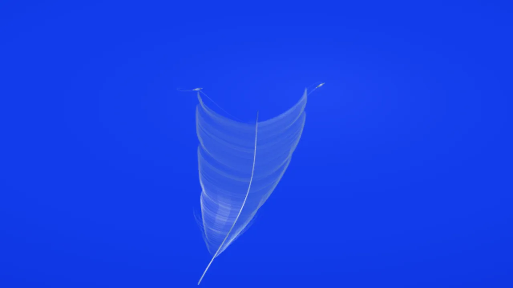</a>
      <br><strong>双路牵丝织形</strong>
      <br><strong>Twin-shuttle weaving</strong>
      <br>双梭牵线穿行，羽丝逐束织出，完成的形体持续保留。
      <br>Two shuttles weave feather-like threads into a shape that remains in place.
      <br><sub>关键帧 / Frame: 15.15 s</sub>
    </td>
    <td width="50%" valign="top">
      <a href="references/effects/generative-point-morph.md">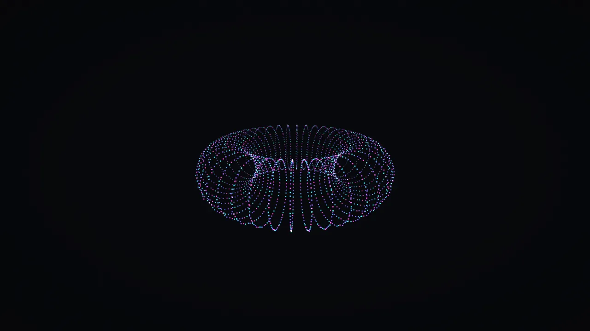</a>
      <br><strong>点阵连续换形</strong>
      <br><strong>Continuous point morphing</strong>
      <br>同一批点连续变为球体、环面与波场，旋转和透视同步变化。
      <br>The same points morph through a sphere, a torus, and a wave field as rotation and perspective change together.
      <br><sub>关键帧 / Frame: 3.65 s</sub>
    </td>
  </tr>
  <tr>
    <td width="50%" valign="top">
      <a href="references/effects/card-conveyor.md"></a>
      <br><strong>斜向双向滚动</strong>
      <br><strong>Opposing diagonal scroll</strong>
      <br>八条卡片带斜向铺展，上下分组反向连续滚动。
      <br>Eight diagonal card lanes scroll continuously, with the upper and lower groups moving in opposite directions.
      <br><sub>关键帧 / Frame: 1.90 s</sub>
    </td>
    <td width="50%" valign="top">
      <a href="references/effects/capsule-impact-scatter.md">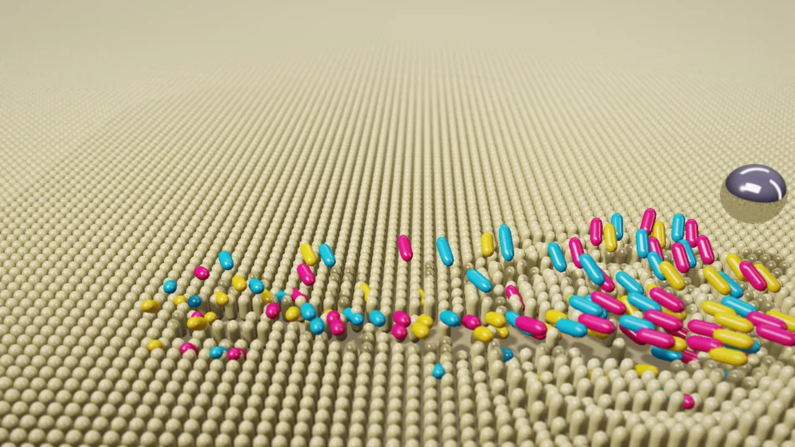</a>
      <br><strong>碰撞掀起胶囊</strong>
      <br><strong>Capsule impact scatter</strong>
      <br>银球碰撞带动胶囊翻飞、回落，提亮波向外扩散。
      <br>A silver ball sends capsules tumbling into the air and falling back as a wave of light spreads outward.
      <br><sub>关键帧 / Frame: 0.90 s</sub>
    </td>
  </tr>
</table>

### 组合片段 / Sequences

多个动作在同一时间线中接续、配合，形成完整片段。

Several motions follow and interact with one another on a shared timeline to form a complete sequence.

<table>
  <tr>
    <td width="50%" valign="top">
      <a href="references/effects/motion-oasis-sequence.md">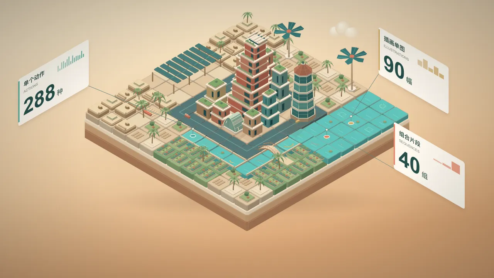</a>
      <br><strong>地块铺展与动效绿洲</strong>
      <br><strong>Unfolding motion oasis</strong>
      <br>地砖逐圈翻开 → 楼群与植被长出 → 水面换图、数据卡展开。
      <br>Tiles flip open in rings → buildings and plants grow → the water image changes and data cards unfold.
      <br><sub>关键帧 / Frame: 3.20 s · 全长 / Duration: 4.95 s</sub>
    </td>
    <td width="50%" valign="top">
      <a href="references/effects/metal-impact-type-sequence.md">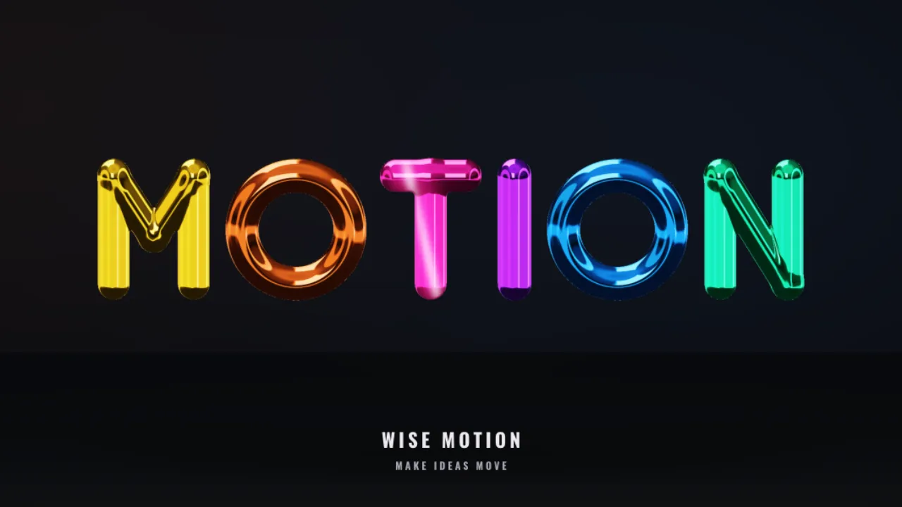</a>
      <br><strong>金属弹开汇聚成字</strong>
      <br><strong>Metal burst into type</strong>
      <br>单球落地分裂 → 六色粒子爆散回收 → 汇成金属字面并扫光。
      <br>A falling ball splits → particles burst out in six colors and return → metallic letters form under a sweep of light.
      <br><sub>关键帧 / Frame: 3.70 s · 全长 / Duration: 5.30 s</sub>
    </td>
  </tr>
  <tr>
    <td width="50%" valign="top">
      <a href="references/effects/glass-interface-sequence.md">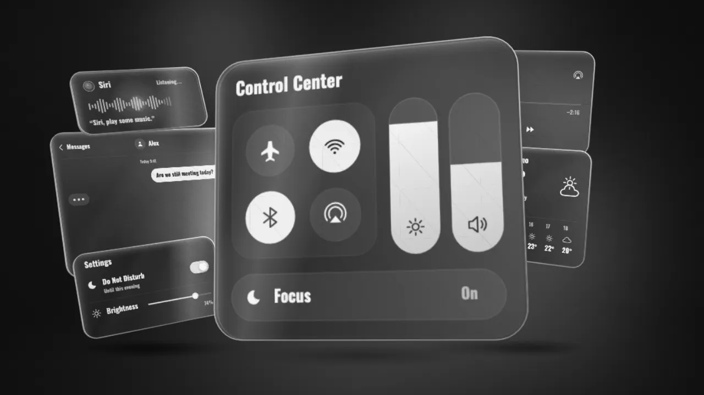</a>
      <br><strong>玻璃卡片显现折射</strong>
      <br><strong>Glass cards and refraction</strong>
      <br>六张空间卡片侧转展开 → 音乐、天气与控制中心接续 → 凸泡折射文字。
      <br>Six cards turn and unfold in space → music, weather, and control panels follow → a convex bubble refracts the text.
      <br><sub>关键帧 / Frame: 3.40 s · 全长 / Duration: 7.20 s</sub>
    </td>
    <td width="50%" valign="top">
      <a href="references/effects/point-domain-flow-sequence.md">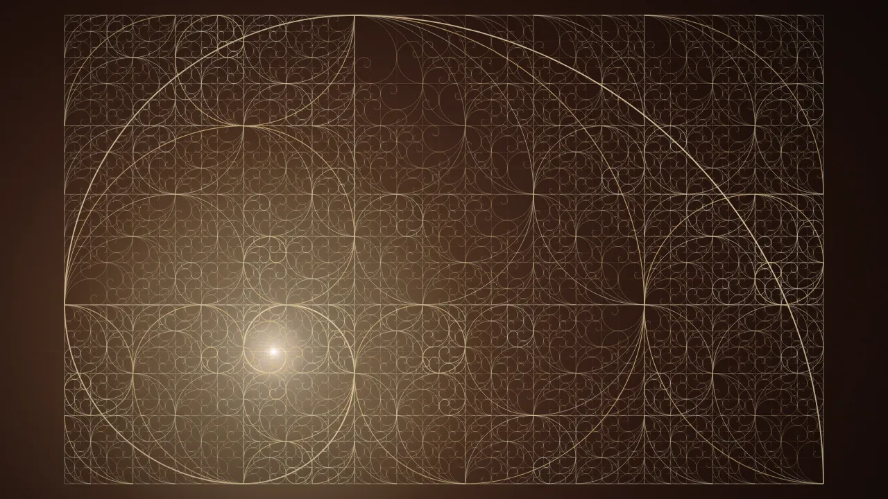</a>
      <br><strong>黄金矩形递归生长</strong>
      <br><strong>Recursive golden rectangles</strong>
      <br>网格建立并推近 → 字符雨幕与铁花交接 → 黄金矩形递归长满画面。
      <br>A grid forms as the view moves closer → character rain transitions into sparks → recursive golden rectangles fill the frame.
      <br><sub>关键帧 / Frame: 20.40 s · 全长约 / Duration: ~21.13 s</sub>
    </td>
  </tr>
  <tr>
    <td width="50%" valign="top">
      <a href="references/effects/seed-bloom-brand-sequence.md">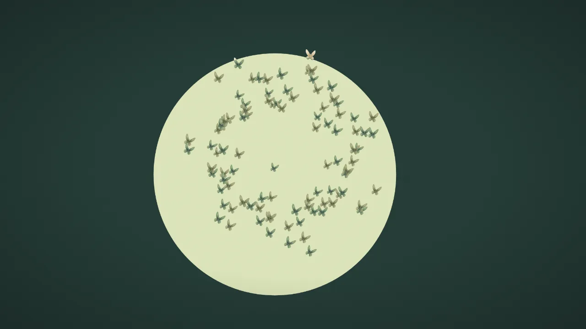</a>
      <br><strong>生长化蝶与光形字标</strong>
      <br><strong>Seed, butterflies, and a wordmark of light</strong>
      <br>种子长成蒲公英 → 炸开旋转化蝶、汇成太阳 → 光束回弹接字标。
      <br>A seed grows into a dandelion → it bursts into swirling butterflies that gather into a sun → a rebounding beam reveals the wordmark.
      <br><sub>关键帧 / Frame: 2.80 s · 全长 / Duration: 8.20 s</sub>
    </td>
    <td width="50%" valign="top">
      <a href="references/effects/civilization-growth-sequence.md">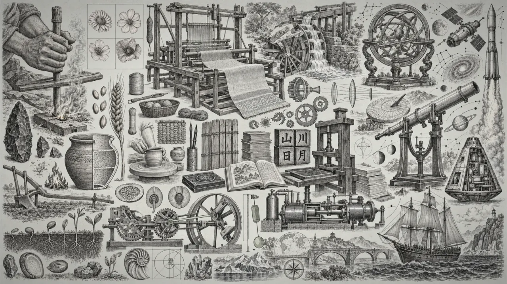</a>
      <br><strong>薪火生长与文明聚字</strong>
      <br><strong>Growing civilization into type</strong>
      <br>草楷火字变换 → 种子、植物与花依次生长 → 文明群像散成粒子聚字。
      <br>The Chinese character for fire shifts between cursive and regular script → seeds, plants, and flowers grow → scenes of civilization dissolve into particles that form text.
      <br><sub>关键帧 / Frame: 14.20 s · 全长 / Duration: 18.60 s</sub>
    </td>
  </tr>
</table>

### 插画单图 / Illustrations

独立取用完整主体，保留它自带的局部动作、材质和光效。

Reuse a complete visual subject with its own local motion, materials, and lighting intact.

<table>
  <tr>
    <td width="50%" valign="top">
      <a href="references/effects/butterfly-illustration.md">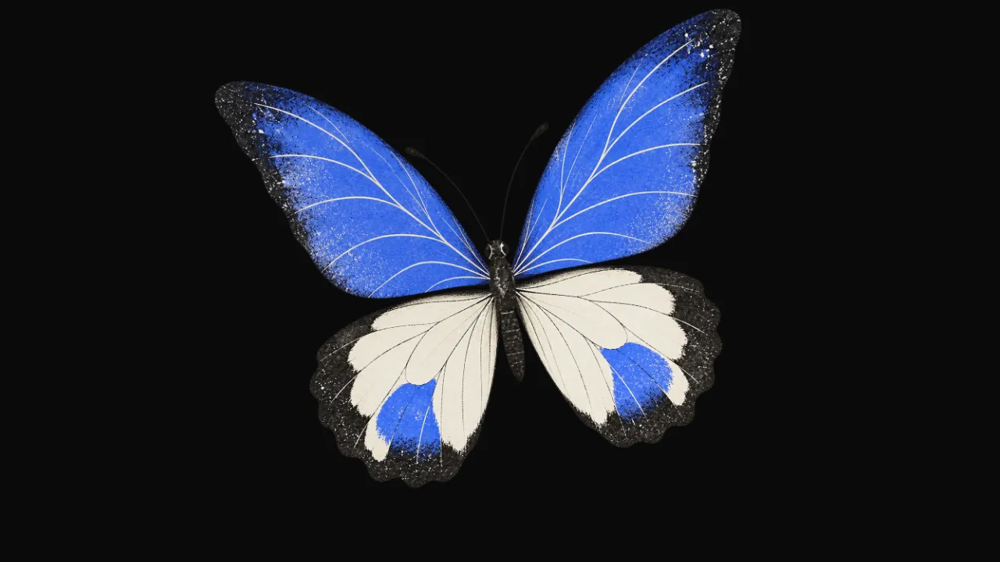</a>
      <br><strong>版画蝴蝶</strong>
      <br><strong>Print-style butterfly</strong>
      <br>四翼错拍开合，触角随振翅弯曲，身体轻浮。
      <br>Four wings beat out of phase, the antennae bend with each beat, and the body gently floats.
      <br><sub>关键帧 / Frame: 1.10 s</sub>
    </td>
    <td width="50%" valign="top">
      <a href="references/effects/drive-car-illustration.md"></a>
      <br><strong>小葵敞篷车</strong>
      <br><strong>Xiaokui's convertible</strong>
      <br>车轮随行程转动，方向盘轻摆，车身微微起伏。
      <br>The wheels turn with travel, the steering wheel sways, and the car body gently bobs.
      <br><sub>关键帧 / Frame: 1.65 s</sub>
    </td>
  </tr>
  <tr>
    <td width="50%" valign="top">
      <a href="references/effects/moon-card-illustration.md">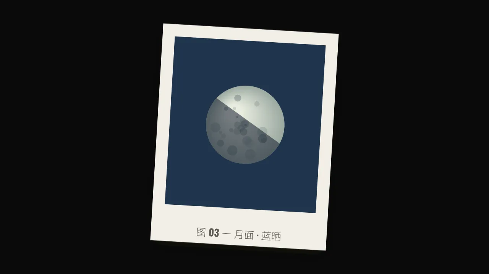</a>
      <br><strong>月相照片卡</strong>
      <br><strong>Moon phase photo card</strong>
      <br>纸卡落位，保留月面、环形山与月相暗部。
      <br>A paper card settles into place, preserving the lunar surface, craters, and the shadowed phase.
      <br><sub>关键帧 / Frame: 2.90 s</sub>
    </td>
    <td width="50%" valign="top">
      <a href="references/effects/rasengan-illustration.md">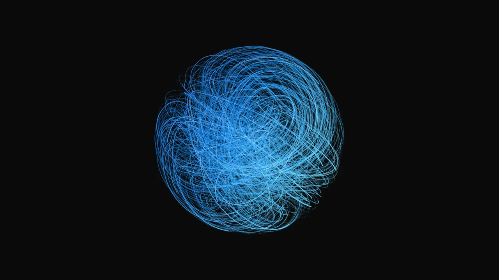</a>
      <br><strong>蓝色能量球</strong>
      <br><strong>Blue energy sphere</strong>
      <br>细蓝流线沿球涡轨迹缠绕，亮芯与线身共同形成球形。
      <br>Fine blue streamlines follow swirling paths, forming a sphere around a bright core.
      <br><sub>关键帧 / Frame: 2.60 s</sub>
    </td>
  </tr>
</table>

## 浏览与使用 / Browse and use

直接打开 [动效目录](catalog/index.html)，无需安装依赖或启动服务器。搜索覆盖全部动作、组合和插画，不受当前页签或分类限制；清空搜索后回到当前页签浏览。选择条目后可预览、调整参数，再复制提示词或源码。

Open the [motion catalog](catalog/index.html) directly from your local files; no dependency installation or server is needed. Search covers all motions, sequences, and illustrations, regardless of the active tab or category. Clearing the search returns you to the active tab. Select an entry to preview it, adjust its parameters, and copy its prompt or source code.

在工具中明确选择 **Wise Motion**，例如：

Explicitly select **Wise Motion** in your AI tool, for example:

```text
$wise-motion 找两排卡片反向持续滚动的参考，不要停顿，导出源码到我的工程。
$wise-motion 找“标题先出现、卡片依次展开、最后转场”的参考，分别说明覆盖与缺口。
```

```text
$wise-motion Find a reference for two rows of cards scrolling continuously in opposite directions without pauses, and export the source code into my project.
$wise-motion Find references for a title appearing first, cards unfolding one by one, and a final transition. Explain what each reference covers and what is missing.
```

全局入口直接链接到技能实际源码：共享入口 `~/.agents/skills/wise-motion`，Codex 入口 `~/.codex/skills/wise-motion`，ZCode 入口 `~/.zcode/skills/wise-motion`。保持仅手动调用；已有入口先核对指向。

Global skill entries should link directly to the actual source directory: `~/.agents/skills/wise-motion` for shared use, `~/.codex/skills/wise-motion` for Codex, and `~/.zcode/skills/wise-motion` for ZCode. Keep invocation manual, and check where an existing entry points before changing it.

目录界面和所链接的详细资料目前以中文为主。

The catalog interface and linked detailed guides are currently primarily in Chinese.

## 检索与源码导出 / Search and export source code

以下用 `<skill-directory>` 表示安装入口解析后的实际技能目录；输出路径请替换为自己的目标工程目录。这些命令可从任意工作目录运行。检索、查看、导出只需 Node.js；版本要求见 [package.json](package.json)。

Replace `<skill-directory>` with the actual directory resolved from your skill entry, and replace the output path with a directory in your own project. These commands work from any working directory. Searching, inspecting, and exporting require only Node.js; see [package.json](package.json) for the supported versions.

```sh
node "<skill-directory>/scripts/match.mjs" "卡片依次上移显现，落位后保留，不要弹跳"
node "<skill-directory>/scripts/show.mjs" stagger-in
node "<skill-directory>/scripts/export.mjs" stagger-in --out-dir "/path/to/project/card-motion"
```

检索示例的含义是“卡片依次向上进入并留在原位，不要弹跳”；命令行检索词与中文目录匹配，可由调用方的 AI 将英文需求转换为中文检索词。

The search example means “cards enter upward one by one and stay in place, without bouncing.” Command-line queries match the Chinese catalog; the AI using this skill can translate an English request into Chinese search terms.

`show` 默认提供简短接入信息，加 `--details` 查看动作阶段与内容限制。`export` 支持 `--variant <variant-id>`，与目录“复制源码”共用生成逻辑；可写入现有目录，任一目标文件已存在时整批停止，不覆盖文件。

`show` returns concise integration guidance by default; add `--details` for motion phases and content constraints. `export` accepts `--variant <variant-id>` and uses the same generation logic as the catalog's “复制源码” (Copy source) action. It can write into an existing directory, but stops the entire export if any destination file already exists; it never overwrites files.

已有独立工程的条目导出全部工程文件；普通条目导出组件接入示例、安装程序和说明，在目标工程运行 `node install-wise-motion.cjs` 安装共享组件包，再按说明准备素材。安装程序优先使用当前交付版本；尚未上架时自动降级为同系列最近的已发布稳定版，显示并固定实际版本，配套依赖随所选包安装。导出本身不会安装依赖，源码写入文件后返回绝对路径。见 [快速上手](references/quickstart.md) 和 [组件说明](REMOTION.md)。

Entries with standalone projects export all project files. Other entries export a component integration example, an installer, and instructions. Run `node install-wise-motion.cjs` in the destination project to install the shared component package, then prepare the assets as instructed. The installer prefers the version delivered with the export; if it is not yet published, it falls back to the latest published stable version in the same release series, displays and pins the selected version, and installs its companion dependencies. Exporting itself does not install dependencies and returns absolute paths after writing the files. See the [quick start](references/quickstart.md) and [component guide](REMOTION.md).

## 播放与渲染 / Playback and rendering

现有播放器、声音、渲染能力继续保留。需要导出单个动效视频时，在技能目录准备依赖后执行：

Playback, audio, and rendering remain available. To render an individual motion as a video, install the dependencies and run these commands in the skill directory, replacing the output directory with your own:

```sh
npm ci
npm run build
WISE_MOTION_RENDER_DIR="/path/to/project/renders" npm run render -- stagger-in stagger-in.mp4
```

视频渲染使用 Remotion 临时服务；本地目录可直接打开。文件名或绝对输出路径必须位于指定产物目录内。

Video rendering uses a temporary Remotion server; browsing the local catalog does not require one. The output filename or absolute output path must stay within the designated render directory.

维护时按 [验证范围与命令](references/validation-matrix.md) 选择检查；局部测试统一使用 `npm run test:files -- tests/<test-name>.test.mjs`，将占位符替换为实际测试文件名。全量 `npm test` 另需本地私有历史档案。人工播放见 [验收步骤](tests/manual.md)，目录维护见 [维护说明](references/catalog-maintenance.md)。

For maintenance, choose checks from the [validation matrix](references/validation-matrix.md). Run selected tests with `npm run test:files -- tests/<test-name>.test.mjs`, replacing the placeholder with the actual test filename. The full `npm test` suite also requires local private historical archives. See the [manual playback checks](tests/manual.md) and [catalog maintenance guide](references/catalog-maintenance.md).

维护者可通过 GitHub 可信发布自动构建并上传 npm，无需长期发包密钥；支持版本标签触发和手动试运行，见 [自动发布说明](references/publishing.md)。

Maintainers can use npm trusted publishing through GitHub Actions to build and publish without a long-lived publishing token. Version tags trigger releases, and manual dry runs are supported; see the [automated publishing guide](references/publishing.md).

## 获取完整三维工程 / Get the complete 3D project

最新横屏 TIME, IN MOTION 收录 10 个独立动作与 44 秒完整组合。文字、刻度、剪辑及三维制作源码随独立工程导出；npm 只提供轻量运行素材。原剪辑媒体与 Blender 场景按摘要单独准备，见 [动作、源码与制作素材](catalog/assets/time-in-motion/README.md)。旧怀表条目与运行素材已替换，旧书签对应到新条目。

The latest landscape edition of TIME, IN MOTION includes 10 individual motions and a complete 44-second sequence. Standalone exports include the text, tick marks, editing, and 3D production source code; npm carries only lightweight runtime assets. Original editing media and Blender scenes are prepared separately and verified against checksums; see [motions, source code, and production assets](catalog/assets/time-in-motion/README.md). The old pocket-watch entries and runtime assets have been replaced, and old bookmarks map to the new entries.

## 持续窗口与机械细节 / Persistent windows and mechanical detail

MECHANICAL WINDOWS 第二版收录4个新动作、圆孔展开与闪切的2个新示例，以及32秒完整组合。窗口独立于镜头持续运行；原创几何与剪辑源码可编辑。轻量缓存静音，原媒体与配乐按需准备，见 [动作与源码说明](catalog/assets/mechanical-windows/README.md)。

The second edition of MECHANICAL WINDOWS includes four new motions, two new examples for circular aperture opening and flash cuts, and a complete 32-second sequence. The windows keep running independently of the camera; the original geometry and editing source code remain editable. Lightweight playback caches are silent, while original media and music are prepared as needed; see the [motion and source guide](catalog/assets/mechanical-windows/README.md).

## 发布组件包 / Publish the component package

维护者先构建、检查并用 `npm pack --pack-destination /path/to/releases` 生成包，将发布目录和版本占位符替换为实际值，再执行：

Maintainers should first build, validate, and create a package with `npm pack --pack-destination /path/to/releases`. Replace the release directory and version placeholder with the actual values, then run:

```sh
npm run publish:package -- /path/to/releases/wise-motion-<version>.tgz --dry-run
npm run publish:package -- /path/to/releases/wise-motion-<version>.tgz
```

发布脚本使用当前 npm 11 客户端向官方仓库发布，保留正常登录与网页身份验证，并压缩上传请求；仅压缩请求仍可能被仓库拒绝，必须控制实际发布包体积。三维制作原件与剪辑原媒体按清单单独准备，运行素材继续随 npm 提供。脚本要求包名称和版本与当前项目一致，并在联网前拒绝超过项目 200 MB 预算的包；这是项目控制体积的约定，不是 npm 官方限制。升级 npm 大版本后需先适配接口并运行 `npm run test:publish`，验证真实请求的压缩和包内容。试运行不会上架，正式发布仍需核对官方仓库的版本与包摘要。

The publishing script uses the current npm 11 client to publish to the official registry, preserves normal login and browser authentication, and compresses the upload request. Compression alone does not guarantee acceptance; the actual package size must stay under control. Original 3D production files and editing media are prepared separately according to their manifests, while runtime assets remain available through npm. The script requires the package name and version to match the current project and rejects packages over the project's 200 MB budget before connecting to the registry. This is a project budget, not an official npm limit. Before upgrading to a new npm major version, adapt the integration and run `npm run test:publish` to verify request compression and package contents. A dry run does not publish anything; after a real release, verify the version and package integrity against the official registry.

## 许可 / License

自有技能与源码使用 **Apache-2.0**，允许商业使用、修改、分发和闭源集成；第三方代码、字体和素材保留各自许可与署名。使用及分发前查阅 [版权与来源说明](NOTICE.md) 和 [完整许可](LICENSE)。

The project's own skill and source code are licensed under **Apache-2.0**, allowing commercial use, modification, redistribution, and integration into closed-source projects. Third-party code, fonts, and assets retain their own licenses and attribution requirements. Read the [notices and sources](NOTICE.md) and the [full license](LICENSE) before use or redistribution.

## 君子约定 / Community pledge

欢迎使用 Wise Motion 制作个人或商业作品，也欢迎修改和集成到自己的项目中。

You are welcome to use Wise Motion in personal or commercial work, modify it, and integrate it into your own projects.

请尊重原创，不要将本项目的源码或动效库原样或稍作包装后，作为付费源码、素材包或收费下载内容出售。

Please respect the original work: do not sell this project's source code or motion library, unchanged or lightly repackaged, as paid source code, asset packs, or paid downloads.

这是一项基于信任的社区倡议，不构成额外的许可证限制，也不改变 Apache-2.0 授予的权利。

This is a voluntary community request based on trust. It adds no license restrictions and does not alter the rights granted by Apache-2.0.
